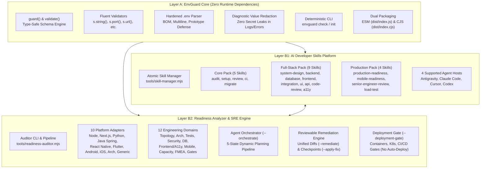

# EnvGuard
### AI-Assisted Software Engineering, Security & Production Readiness

[](https://github.com/SIDDARTHA577/envguard-node/actions/workflows/ci.yml)
[](https://github.com/SIDDARTHA577/envguard-node/actions/workflows/codeql.yml)
[](https://opensource.org/licenses/MIT)
[](https://nodejs.org/)

EnvGuard is an open-source developer engineering toolkit that helps teams design, review, test, secure, and prepare applications for production. It combines a lightweight Node.js environment configuration validation library, 18 specialized AI Agent Skills, and an evidence-based application readiness analyzer for web, backend, mobile, and full-stack projects.

> [!NOTE]
> **Assistant Scope & Human Approval**: EnvGuard assists engineers and AI coding agents by surfacing empirical evidence, structured risks, and reviewable recommendations. It does not autonomously guarantee application security or replace human engineering approval for production releases.

---

> [!IMPORTANT]
> **Pre-Release Notice**: EnvGuard is currently under active pre-release development. The core library, agent skills, and readiness tooling are undergoing systematic evaluation prior to public distribution. The package has **not yet been published to the public npm registry**, and no public Git release tags have been cut.
> 
> To evaluate EnvGuard today, follow the tested **[Pre-Release Local Source Installation](#g-getting-started)** instructions below.

---

## Table of Contents

- [A. Project Overview](#a-project-overview)
- [B. Why EnvGuard?](#b-why-envguard)
- [C. Architecture Overview](#c-architecture-overview)
- [D. Key Capabilities](#d-key-capabilities)
- [E. Supported Technologies Matrix](#e-supported-technologies-matrix)
- [F. All 18 AI Coding Agent Skills](#f-all-18-ai-coding-agent-skills)
- [G. Getting Started](#g-getting-started)
- [H. Core Library Example](#h-core-library-example)
- [I. AI Skill Installation Across Hosts](#i-ai-skill-installation-across-hosts)
- [J. End-to-End Developer Workflow](#j-end-to-end-developer-workflow)
- [K. Readiness Report Example](#k-readiness-report-example)
- [L. Security & Privacy Model](#l-security--privacy-model)
- [M. Testing & Quality Assurance](#m-testing--quality-assurance)
- [N. Roadmap & Project Status](#n-roadmap--project-status)
- [O. Contributing](#o-contributing)
- [P. License](#p-license)
- [Q. Maintainer & Links](#q-maintainer--links)

---

## A. Project Overview

Modern software applications frequently suffer outages, configuration drift, and security regressions due to unvalidated environment variables, untracked credentials, unverified API contracts, and missing production readiness gates.

EnvGuard was created to solve these challenges through a unified, modular toolkit:
1. **Lightweight Core Library**: Type-safe runtime schema validation with built-in diagnostic redaction to ensure secrets never leak into logs, error messages, or terminal reports.
2. **AI Developer Skills**: 18 specialized skills that allow AI coding agents (**Google Antigravity**, **Claude Code**, **Cursor IDE**, and **OpenAI Codex**) to conduct deep architecture reviews, full-stack implementations, mobile assessments, and load testing safely.
3. **Multi-Platform Readiness Analyzer**: Static and authorized dynamic assessment engine covering 10 platforms and 12 engineering domains with deterministic exit codes.
4. **Senior System-Design & Architecture Review**: Automated evaluation across 17 mandatory distributed systems concepts, non-functional requirements (NFRs), and Architecture Decision Record (ADR) generation.
5. **Reviewable Remediation & Retesting**: Automated formulation of non-destructive patches with unified diff previews, atomic rollback checkpoints, and comparative verification.

### How EnvGuard Differs from Basic Environment Validators

| Capability | Basic Environment Validators (`dotenv-safe`, `envalid`, `joi`) | EnvGuard (`envguard-node`) |
| :--- | :---: | :---: |
| **Runtime Dependencies** | Usually requires 1–5 external dependencies | **0 runtime dependencies** (Pure Node.js standard library) |
| **Diagnostic Secret Redaction** | Often echoes invalid values in error messages | **Guaranteed redaction** in errors, stack traces, and JSON outputs |
| **AI Coding Agent Integration** | None | **18 portable Agent Skills** across 4 host environments |
| **Platform Scope** | Node.js environment variables only | **10 platforms** (Node, Next.js, Python, Java, React Native, Flutter, Android, iOS, Monorepos) |
| **Engineering Assessment** | Environment strings only | **12 domains** (Topology, Arch, Tests, Security, DB, A11y, Mobile, SRE, FMEA) |
| **Deployment Gates** | None | **Container, Kubernetes, & CI/CD gates** with strict no-auto-deploy |
| **Remediation & Rollback** | Manual developer fixes | **Reviewable unified diffs** with atomic rollback checkpoints |

---

## B. Why EnvGuard?

Engineering teams and AI coding agents confront recurring, costly production challenges:

| Developer Challenge | Production Consequence | How EnvGuard Solves It |
| :--- | :--- | :--- |
| **Missing Environment Configuration** | Late-stage crashes deep into runtime request handling. | Fail-fast schema validation at startup via `guard()` and CLI `envguard check`. |
| **Accidental Secret Exposure** | Credentials printed to terminal output, monitoring services, or CI logs. | Redaction architecture strictly omits raw evaluated secrets from diagnostic outputs. |
| **Inconsistent Engineering Practices** | Ad-hoc patterns across frontend, backend, and mobile repositories. | 18 standardized AI Agent Skills providing structured, evidence-based workflows. |
| **Insufficient or Fake Automated Tests** | Silent build regressions or fabricated passing stubs deployed to staging. | Real test-framework discovery, detection of dummy scripts, and mandatory test execution. |
| **Unverified API Contracts** | Broken downstream consumers, missing pagination caps, or inconsistent errors. | Static and schema validation of OpenAPI 3.1 contracts and RFC 9457 Problem Details. |
| **Database Deployment Risks** | Missing migration rollbacks, unindexed foreign keys, or raw SQL injection. | Static inspection of migration reversibility, composite indexing, and pool limits. |
| **Scalability Concerns** | Services collapsing under traffic spikes due to untested concurrency. | Transparent capacity modeling and safe loopback benchmarking (`127.0.0.1` only). |
| **Missing Production Evidence** | Subjective, unverified readiness claims ("it works on my machine"). | Evidence-based JSON and Markdown reports grounded in file paths and command runs. |
| **Difficulty Coordinating Reviews** | Lengthy human review cycles for routine architectural checks. | Autonomous multi-stage agent orchestration (`--orchestrate`) emitting reviewable artifacts. |

---

## C. Architecture Overview

EnvGuard is architected across three decoupled layers:



- **Layer A (EnvGuard Core)**: Independent, zero-dependency validation engine, parser, and deterministic CLI. Safe for production server entrypoints.
- **Layer B1 (AI Developer Skills)**: 18 modular agent skills formatted with standardized triggers, workflows, boundaries, and validation steps.
- **Layer B2 (Readiness Auditor & SRE Engine)**: Deep evaluation pipeline coordinating adapters, security trust models, container analysis, and reviewable patch generation.

---

## D. Key Capabilities

EnvGuard separates findings into **automated static detection**, **authorized dynamic verification**, and **manual engineering review**:

| Engineering Domain | Automated Static Detection | Authorized Dynamic Verification (`--allow-exec`) | Manual Engineering Review |
| :--- | :--- | :--- | :--- |
| **Environment Configuration** | Missing templates, unignored `.env`, missing startup schemas | Entrypoint boot dry-run validation | Schema business logic alignment |
| **Build & Test Pipelines** | Missing `package.json` scripts, fake test stubs | Sandboxed execution of `npm test` and `npm run build` | Test coverage quality & assertions |
| **Security Posture** | Secret leakage heuristics, missing middleware, hardcoded keys | Authorized dependency vulnerability audits | Threat modeling & auth architecture |
| **API Contract Design** | OpenAPI 3.1 syntax, RPC verbs, RFC 9457 Problem Details | HTTP endpoint schema validation | Business domain boundary cohesion |
| **Database Persistence** | Raw SQL concatenation, migration reversibility, indexing | Connection pool initialization & query plan analysis | Data modeling & sharding strategy |
| **Frontend & Accessibility** | Public boundary leaks, semantic HTML, ARIA patterns | Headless render checks & focus trap analysis | Visual token cohesion & UX flow |
| **Mobile Readiness** | Cleartext storage, exported components, deep link schemes | Static binary structure & manifest verification | Device hardware permission review |
| **Capacity & Scalability** | Transparent Little's Law modeling, 10k-VU scenarios | Loopback-only (`127.0.0.1`) latency benchmarking | Cross-region failover & CDN caching |
| **Deployment Gates** | Unprivileged container `USER`, health probes, k8s security | CI/CD deployment dependency verification | Production release authorization |

---

## E. Supported Technologies Matrix

EnvGuard provides specialized discovery, inspection, and verification across modern application stacks:

| Project Archetype | Primary Stacks | Static Analysis | Dynamic Verification | Tool Requirements | Platform Status |
| :--- | :--- | :---: | :---: | :--- | :---: |
| **Web Frontend** | React, Next.js (App Router), Vite, TypeScript | :white_check_mark: Full | :white_check_mark: Full | Node.js LTS | :white_check_mark: Production Ready |
| **Node.js Backend** | Express, Fastify, NestJS, Prisma, TypeORM | :white_check_mark: Full | :white_check_mark: Full | Node.js LTS | :white_check_mark: Production Ready |
| **Python Backend** | Django 5.x, FastAPI, Flask, Pydantic, SQLAlchemy | :white_check_mark: Full | :white_check_mark: Full | Python 3.10+, pip | :white_check_mark: Production Ready |
| **Java Enterprise** | Spring Boot 3.x, Maven, Gradle, JPA | :white_check_mark: Full | :white_check_mark: Full | JDK 17+, Maven/Gradle | :white_check_mark: Production Ready |
| **Cross-Platform Mobile** | React Native, Expo, Flutter, Dart | :white_check_mark: Full | :white_check_mark: Full | Node.js, Flutter SDK | :white_check_mark: Production Ready |
| **Native Android** | Kotlin, Java, Android Gradle Plugin | :white_check_mark: Full | :white_check_mark: Full | Android SDK, Gradle | :white_check_mark: Production Ready |
| **Native iOS** | Swift, SwiftUI, Package.swift, Xcode project | :white_check_mark: Full | :warning: macOS Only | Xcode (macOS only) | :white_check_mark: Verified (Static on Win/Linux) |
| **Polyglot Monorepo** | Turborepo, Nx, pnpm workspaces | :white_check_mark: Full | :white_check_mark: Full | Workspace root manifest | :white_check_mark: Production Ready |
| **Containers & K8s** | Dockerfile, Docker Compose, Kubernetes manifests | :white_check_mark: Full | :white_check_mark: Full | Container runtime | :white_check_mark: Production Ready |

> [!NOTE]
> **iOS Platform Disclosure**: iOS static structure, `Package.swift` dependencies, ATS configurations, and privacy manifests are fully verified across all platforms (Linux, Windows, macOS). Dynamic compilation and native XCTest suite execution require a macOS host with Xcode command-line tools installed.

---

## F. All 18 AI Coding Agent Skills

EnvGuard provides 18 installable agent skills organized into 3 curated packs:

### 1. Core Configuration & Security Pack (`core` — 5 Skills)
| Skill | Canonical Location | Description |
| :--- | :--- | :--- |
| [`envguard-audit`](./skills/envguard-audit) | `skills/envguard-audit` | Scans source code for `process.env` references and proposes a type-safe schema without reading secrets. |
| [`envguard-setup`](./skills/envguard-setup) | `skills/envguard-setup` | Automates EnvGuard installation, configuration, and entrypoint integration tailored to the project. |
| [`envguard-review`](./skills/envguard-review) | `skills/envguard-review` | Inspects environment handling for common security vulnerabilities, logging leaks, and unmasked errors. |
| [`envguard-ci`](./skills/envguard-ci) | `skills/envguard-ci` | Integrates validation into CI/CD pipelines (GitHub Actions, GitLab CI, Docker entrypoints). |
| [`envguard-migrate`](./skills/envguard-migrate) | `skills/envguard-migrate` | Migrates legacy ad-hoc `process.env` reads to EnvGuard step-by-step with zero regressions. |

### 2. Full-Stack Engineering Pack (`fullstack` — 9 Skills)
| Skill | Canonical Location | Description |
| :--- | :--- | :--- |
| [`envguard-system-design`](./packs/fullstack/skills/envguard-system-design) | `packs/fullstack/...` | Evaluates 17 distributed design concepts, non-functional requirements, and ADR generation. |
| [`envguard-backend`](./packs/fullstack/skills/envguard-backend) | `packs/fullstack/...` | Guides design and testing of secure, production-grade Node.js and TypeScript backend APIs. |
| [`envguard-database`](./packs/fullstack/skills/envguard-database) | `packs/fullstack/...` | Schema design, composite indexing, expand/contract migrations, and connection pool optimization. |
| [`envguard-frontend`](./packs/fullstack/skills/envguard-frontend) | `packs/fullstack/...` | Responsive component development with React/TypeScript, form validation, and state isolation. |
| [`envguard-fullstack-integration`](./packs/fullstack/skills/envguard-fullstack-integration) | `packs/fullstack/...` | End-to-end integration across React frontends, Node APIs, shared contracts, and CORS boundaries. |
| [`envguard-ui-design`](./packs/fullstack/skills/envguard-ui-design) | `packs/fullstack/...` | Design tokens, standardized typography, spacing scales, responsive layout grids, and component anatomy. |
| [`envguard-api-design`](./packs/fullstack/skills/envguard-api-design) | `packs/fullstack/...` | RESTful APIs with OpenAPI 3.1 contracts, RFC 9457 Problem Details, pagination, and backward compatibility. |
| [`envguard-code-review`](./packs/fullstack/skills/envguard-code-review) | `packs/fullstack/...` | Rigorous evidence-based code reviews evaluating correctness, edge cases, performance, and breaking changes. |
| [`envguard-accessibility`](./packs/fullstack/skills/envguard-accessibility) | `packs/fullstack/...` | WCAG 2.1/2.2 AA audits, semantic HTML, keyboard navigation, focus traps, and color contrast. |

### 3. Production Readiness & SRE Pack (`production` — 4 Skills)
| Skill | Canonical Location | Description |
| :--- | :--- | :--- |
| [`envguard-production-readiness`](./packs/production/skills/envguard-production-readiness) | `packs/production/...` | Comprehensive 12-domain production readiness assessment across build, security, APIs, database, and reliability. |
| [`envguard-mobile-readiness`](./packs/production/skills/envguard-mobile-readiness) | `packs/production/...` | Mobile app readiness for React Native, Expo, Flutter, Android, and iOS aligned with OWASP MASVS v2.0. |
| [`envguard-senior-engineer-review`](./packs/production/skills/envguard-senior-engineer-review) | `packs/production/...` | Flagship architect review coordinating full-stack discovery, multi-adapter analysis, capacity planning, and ADRs. |
| [`envguard-load-test`](./packs/production/skills/envguard-load-test) | `packs/production/...` | Capacity planning, transparent 10k-VU workload scenario modeling, and safe local HTTP benchmarking. |

---

## G. Getting Started

### Prerequisites
- **Node.js**: Maintained Active or Maintenance LTS release (`^22.0.0 || ^24.0.0 || ^26.0.0`).
- **Git**: Installed and available in your shell.

### 1. Pre-Release Local Source Installation (Current Mode)
Clone the repository, install development dependencies, and run validation gates:

```bash
# Clone the repository
git clone https://github.com/SIDDARTHA577/envguard-node.git
cd envguard-node

# Install development dependencies
npm ci

# Compile TypeScript distribution (ESM + CommonJS)
npm run build

# Verify quality gates
npm run typecheck
npm run lint
npm test
npm run skills:verify
```

### 2. Local npm Tarball Installation (Consume in External Projects)
You can package EnvGuard locally into an isolated tarball to consume in any local Node.js application:

```bash
# Generate the tarball in the envguard-node directory
npm pack

# In your target application repository:
npm install /path/to/envguard-node/envguard-node-1.0.0.tgz
```

### 3. Future Public npm Installation (Post-Release)
*Once the maintainer approves and publishes the initial release, standard registry installation will be available:*

```bash
# Standard registry installation (available upon official v1.0.0 public release)
npm install envguard-node
```

---

## H. Core Library Example

EnvGuard's core library is pure JavaScript/TypeScript with **zero dependencies**. It supports both ESM (`import`) and CommonJS (`require`).

### Tested TypeScript Entrypoint Example

```typescript
import { guard, s } from 'envguard-node';

// Define typed environment schema with diagnostic secret redaction
const result = guard({
  PORT: s.port().default(3000),
  NODE_ENV: s.enum(['development', 'test', 'production'] as const).default('development'),
  DATABASE_URL: s.url({ protocols: ['postgres:', 'postgresql:'] }).sensitive(),
  ENABLE_METRICS: s.boolean().default(false),
  API_SECRET_KEY: s.string({ min: 16 }).sensitive(),
}, process.env, { throwOnError: false });

if (!result.success) {
  // Built-in diagnostics omit raw evaluated secret values
  console.error('Environment configuration failed validation:');
  for (const issue of result.errors) {
    console.error(` - [${issue.key}] (${issue.issue}): ${issue.message}`);
  }
  process.exit(1);
}

// Strictly typed and coerced configuration values:
// result.data.PORT -> number (e.g. 3000)
// result.data.DATABASE_URL -> string
// result.data.ENABLE_METRICS -> boolean
const config = result.data;
console.log(`Server starting on port ${config.PORT} in ${config.NODE_ENV} mode`);
```

### Available Validators & Modifiers

| Validator | Options & Constraints | Example |
| :--- | :--- | :--- |
| `s.string(opts?)` | Minimum length, maximum length, regex pattern, trim | `s.string({ min: 8 }).trim()` |
| `s.port(opts?)` | Valid network ports `1` through `65535` (coerced to number) | `s.port().default(8080)` |
| `s.url(opts?)` | Absolute URLs with protocol allowlist | `s.url({ protocols: ['https:'] })` |
| `s.boolean(opts?)` | Coerces `"true"`, `"false"`, `"1"`, `"0"`, `"yes"`, `"no"` | `s.boolean().default(false)` |
| `s.number(opts?)` | Coerced floating-point numbers with min/max bounds | `s.number({ min: 0 })` |
| `s.integer(opts?)` | Whole numbers only | `s.integer().default(10)` |
| `s.enum(values)` | Union of allowed string values | `s.enum(['dev', 'prod'] as const)` |

Modifiers include `.optional()`, `.default(value)`, `.sensitive()`, `.describe(text)`, and `.custom((val) => boolean | string)`.

---

## I. AI Skill Installation Across Hosts

The atomic skill manager (`tools/skill-manager.mjs`) installs skill packs into target project repositories with SHA-256 integrity verification, collision detection, and safe uninstallation.

```bash
# 1. Install for Google Antigravity (skills/):
node tools/skill-manager.mjs install --pack fullstack --dest /path/to/project --target antigravity

# 2. Install for Claude Code (.claude/skills/):
node tools/skill-manager.mjs install --pack core --dest /path/to/project --target claude-code

# 3. Install for Cursor IDE (.cursor/skills/):
node tools/skill-manager.mjs install --pack production --dest /path/to/project --target cursor

# 4. Install for OpenAI Codex (.agents/skills/):
node tools/skill-manager.mjs install --pack all --dest /path/to/project --target codex
```

> [!NOTE]
> **Directory Compatibility vs Native Host Verification**: "DIRECTORY_COMPATIBLE" indicates that skill directory layouts, YAML frontmatter, instruction sections, and tool wrappers were verified against each host's published specification. It does not claim that vendor proprietary models executed in headless CI runners.

---

## J. End-to-End Developer Workflow

EnvGuard provides a complete, reviewable workflow from initial discovery through retesting:

```
DISCOVER APPLICATION
   │
   ▼
ASSESS ARCHITECTURE & REQUIREMENTS (17 Concepts, NFRs)
   │
   ▼
SELECT RELEVANT SKILLS (Core, Fullstack, Production)
   │
   ▼
RUN READ-ONLY AUDIT (Static Heuristics & Schema Inspection)
   │
   ▼
REQUEST EXECUTION APPROVAL (--preview-commands)
   │
   ▼
RUN AUTHORIZED TESTS & BENCHMARKS (--allow-exec --trust-project)
   │
   ▼
ANALYZE FINDINGS & EVALUATE DEPLOYMENT GATE (--deployment-gate)
   │
   ▼
PROPOSE REVIEWABLE FIXES (--remediate, Unified Diffs)
   │
   ▼
APPLY APPROVED PATCHES WITH CHECKPOINTS (--apply-fix)
   │
   ▼
RETEST & COMPARE AGAINST BASELINE (--compare)
```

### Working CLI Commands

```bash
# 1. Read-only audit across 12 domains:
node tools/readiness-auditor.mjs scan --project . --output-dir ./reports --format both

# 2. Autonomous multi-stage agent orchestration:
node tools/readiness-auditor.mjs --orchestrate --project . --output-dir ./reports

# 3. Preview execution commands before granting authorization:
node tools/readiness-auditor.mjs scan --project . --preview-commands

# 4. Preview reviewable remediation patches as unified diffs (dry-run):
node tools/readiness-auditor.mjs --remediate --project .

# 5. Apply approved patches with automatic rollback checkpoints and retesting:
node tools/readiness-auditor.mjs --apply-fix --project .

# 6. Evaluate deployment readiness gates (containers, k8s, CI/CD):
node tools/readiness-auditor.mjs --deployment-gate --project .

# 7. Compare before and after reports to confirm zero regressions:
node tools/readiness-auditor.mjs --compare reports/before.json reports/after.json --output-dir ./reports
```

---

## K. Readiness Report Example

Below is a sanitized excerpt from an automated EnvGuard readiness report generated against a controlled test fixture:

```markdown
# EnvGuard Production Readiness Assessment Report

**Project**: `api-service-monolith`  
**Platform**: Node.js v24.x on linux-x64  
**Release Gate Verdict**: ❌ BLOCKED  

## 1. Summary of Assessment Checks

| Status | Count | Description |
| :--- | :---: | :--- |
| **PASS** | 22 | Verified passing criteria across architecture and code |
| **FAIL** | 2 | P0 blocking failures requiring remediation |
| **WARNING** | 7 | Non-blocking risks or missing best-practice conventions |
| **NOT_RUN** | 1 | Checks skipped (read-only mode active; requires --allow-exec) |
| **MANUAL_REVIEW** | 1 | Ambiguous test configuration requiring engineer review |
| **NOT_APPLICABLE** | 4 | Checks irrelevant to detected project type |

## 2. Blocking Failures (P0)

### [ENV-001] Missing Environment Variable Template (.env.example)
- **Severity**: HIGH | **Confidence**: verified_fact
- **Explanation**: No .env.example template file found in project root. Deployment engineers cannot verify required configuration keys.
- **Recommendation**: Formulate safe template using "node tools/readiness-auditor.mjs --remediate".

### [SEC-005] Hardcoded Secret In Source Code
- **Severity**: CRITICAL | **Confidence**: verified_fact
- **Explanation**: Discovered high-entropy credential string in auth controller.
- **Evidence**: `src/auth/jwt.ts:14`
- **Recommendation**: Move secret to environment variable and inject via secure vault at runtime.
```

---

## L. Security & Privacy Model

- **Read-Only by Default**: The auditor never executes project code, package scripts, or external commands unless explicit authorization flags (`--allow-exec`) and verified containment (`--trust-project` or container boundary) are provided.
- **Diagnostic Secret Redaction**: Built-in error messages, serialized exceptions, and JSON outputs are designed and tested not to include evaluated secret values.
- **Safe Dotenv Parser**: Pure JavaScript parser. Does not execute shell commands, backticks, or subshell substitutions.
- **Prototype Pollution Defense**: Explicitly rejects `__proto__`, `constructor`, and `prototype` keys during schema ingestion and JSON loading.
- **Strict No-Auto-Deploy Guard**: The deployment gate evaluates container security, Kubernetes probes, and CI/CD gates, but strictly enforces `autoDeployAllowed: false`. Autonomous agents cannot trigger production deployments.
- **Checkpoint Containment & Concurrent-Edit Protection**: Remediation checkpoints enforce canonical project root containment, reject symlinks/junctions, verify SHA-256 backup/manifest integrity, omit raw secret contents from JSON manifests, and refuse to overwrite concurrent developer modifications.
- **Git History & `.gitignore` Scope**: Updating `.gitignore` prevents untracked secrets from being staged in future commits, but does **not** untrack already-committed files or erase exposed secrets from Git history. Previously committed credentials must be rotated and removed from history separately.
- **Zero Outbound Telemetry**: EnvGuard runs 100% locally with zero external network tracking, phone-home telemetry, or analytics.

See [SECURITY.md](./SECURITY.md) for vulnerability disclosure procedures.

---

## M. Testing & Quality Assurance

EnvGuard enforces rigorous quality assurance across multiple environments:
- **Comprehensive Test Matrix**: 39 test suites containing 499 unit, integration, and security regression tests (100% passing as of November 2026).
- **Supported Runtimes**: Node.js `22.x`, `24.x`, and `26.x` tested on both **Ubuntu Linux** and **Windows Server** via GitHub Actions.
- **Static Analysis & Security**: CodeQL static analysis workflow and ESLint with zero warnings or errors.
- **Zero Runtime Dependencies**: Layer A Core maintains zero third-party dependencies (`dependencies: {}`).
- **Tarball Smoke Tests**: Every commit verifies clean tarball compilation, packaging, and runtime execution across ESM, CommonJS, and CLI binary via `npm run test:pack`.

---

## N. Roadmap & Project Status

EnvGuard is currently under active pre-release development. Its core library, agent skills, and readiness tooling are being evaluated before public distribution.

- [Detailed Engineering Roadmap](./docs/roadmap.md): Complete phase history and planned milestones.
- [Phase 14 Stabilization Report](./docs/phase14-platform-stabilization-report.md): Technical audit report across all 14 development phases.
- [Release Readiness Audit Checklist](./docs/release-readiness-audit.md): Production sign-off checklist for future public release.

---

## O. Contributing

We welcome community feedback, issue reports, and contributions! Please read our [CONTRIBUTING.md](./CONTRIBUTING.md) and [CODE_OF_CONDUCT.md](./CODE_OF_CONDUCT.md) before opening a pull request.

```bash
# Clone and verify the project locally
git clone https://github.com/SIDDARTHA577/envguard-node.git
cd envguard-node
npm ci
npm run typecheck
npm run lint
npm test
npm run test:pack
```

---

## P. License

This project is licensed under the [MIT License](./LICENSE) © 2026 SIDDARTHA577.

---

## Q. Maintainer & Links

- **Repository**: [https://github.com/SIDDARTHA577/envguard-node](https://github.com/SIDDARTHA577/envguard-node)
- **Issue Tracker**: [https://github.com/SIDDARTHA577/envguard-node/issues](https://github.com/SIDDARTHA577/envguard-node/issues)
- **Security Reporting**: [Security Policy](./SECURITY.md)
