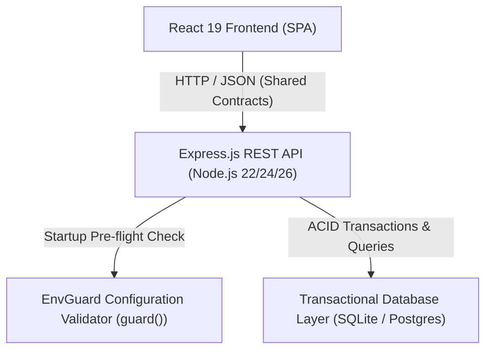
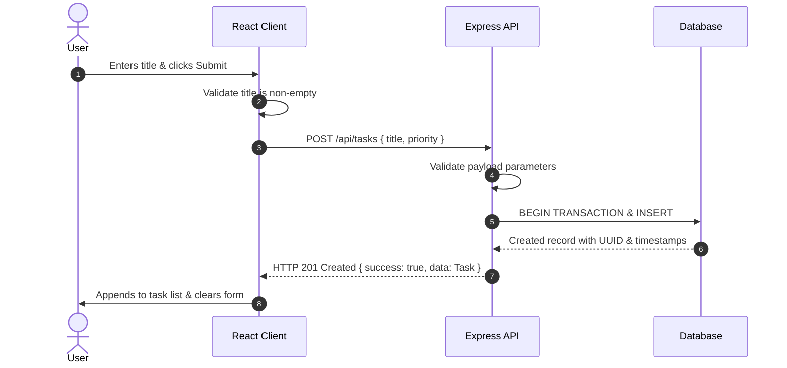

# Task Management System Architecture

This system design document was produced following the `envguard-system-design` and `envguard-fullstack-integration` workflow standards.

## 1. System Overview

The system is a modular full-stack application providing task and project management with fail-fast runtime environment validation, strict CORS boundaries, structured JSON errors, and transactional persistence.

## 2. Component Boundaries & Responsibilities

1. **Client Tier (`src/frontend`)**:
   - Built with React and TypeScript.
   - Responsible for rendering responsive views, client-side input validation, accessible status alerts, and async state management (loading, empty, success, error).
   - Only accesses public client configuration (`VITE_API_BASE_URL`).

2. **API Tier (`src/backend`)**:
   - Built with Node.js and Express in TypeScript.
   - Validates environment configuration at boot time using `guard()`.
   - Enforces CORS policies, input validation on all route parameters and request bodies, and centralized structured error responses.
   - Provides `GET /health` endpoint for readiness/liveness monitoring.

3. **Persistence Tier (`src/backend/db`)**:
   - Implements transactional relational storage with schema migrations, indexes on `status` and `priority`, and ACID rollback capabilities.

## 3. Data Contracts & Sequence

